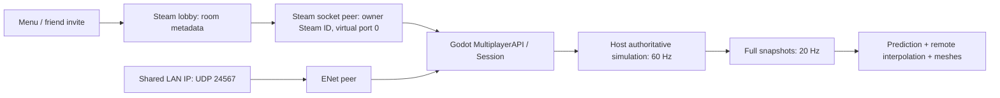

# Bean Workshop: build, understand, and extend a Godot networking game

This is a small **3D, top-down, four-player shooting sandbox**. Characters are
capsules (beans). Guns, pickups, floors, and walls are ordinary box meshes.
You can walk, aim, shoot other players, collect finite resource piles, craft
ammo and wall kits, and place destructible walls. Everything is generated from
readable GDScript; there are no art imports or hidden scene dependencies.

The networking example supports one game model with three transport choices:

| Mode | Find friends | Move game messages | Steam required? |
|---|---|---|---|
| Solo | No other player | In-process calls | No |
| LAN / direct IP | Share host address and UDP port | Godot ENet | No |
| Steam friends lobby | Copy lobby ID or use overlay invites | Steam Networking Sockets through an optional peer | Yes |

The Steam adapter is implemented but **has not been tested with live Steam
accounts** in this environment. Stock Godot 4.6.3, model rules, the assembled
headless scene, and actual loopback ENet multiplayer have been tested. The
optional socket peer's upstream development is paused. Treat it as an explicit
integration boundary to audit or replace, not a promise of current native-binary
compatibility. You can develop and test the complete LAN game immediately.

Read [CODE_TOUR.md](CODE_TOUR.md) for a slow, beginner-oriented explanation of the
scripts and syntax. Read [API.md](API.md) for message shapes and example calls.

## 1. First run, without installing Steam

1. Install the standard Godot **4.6** editor. This is GDScript, so the .NET editor
   is unnecessary. The tested version is **4.6.3**. Do not open this in Godot 3.
2. Import the repository's `project.godot` into Godot's project manager.
3. Open the project and press **F5** to run the main scene.
4. Click **Solo sandbox**. Move the mouse over the floor and try the controls.
5. Craft ammo, craft a wall kit, and place a wall two metres away. Walk into it;
   the shared movement function stops you. Shoot it four times to remove it.
6. Walk near a yellow resource cube and press E to collect it.

| Control | Meaning |
|---|---|
| W / A / S / D | Move on the flat X/Z plane |
| Mouse | Aim the box gun; select a grid square for building |
| Hold left mouse | Request a shot, subject to authoritative ammo/cooldown |
| E | Request the closest resource pile within 2.2 metres |
| C | Craft 12 rounds from 1 wood + 1 metal |
| V | Craft 1 wall kit from 3 wood |
| B | Place a wall kit at the selected cell, within 3 metres |
| I | Open Steam's lobby invite overlay, when in a Steam lobby |
| Escape | Close transport, leave lobby, clear state, return to menu |

Each bean starts with 100 health, 24 rounds, 12 wood, 6 metal, and 1 wall kit.
A shot costs one round and deals 25 damage. The server permits one shot every
12 simulation ticks, or five per second. Defeated players respawn immediately;
inventory is retained. Walls have 100 health. Pickups do not regenerate.

Inventory is a dictionary of stack counts, **not a drag-and-drop slot UI**. There
is one weapon, no jumping, no vertical aim, no reload animation, no persistent
world save, no bots, no teams, and no player-to-player physical collision. These
choices keep the networking model small enough to understand and modify.

### Two copies on your machine

Start two copies of the project, either from the editor's multiple-instance
settings or from separate terminals:

```sh
godot --path /path/to/steamworks-init
godot --path /path/to/steamworks-init
```

In the first copy, click **Host LAN**. In the second, join `127.0.0.1`. Shoot the
other bean and build a wall; both windows should show the same health, walls,
and inventories. The second window's player is predicted locally.

### Friends on the same Wi-Fi or Ethernet network

1. Host chooses Host LAN and finds their local IPv4 address in their OS network
   settings, for example `192.168.1.20`.
2. Allow inbound **UDP 24567** for the host game in the OS firewall.
3. Friends join `192.168.1.20`. Everyone must have the same project/protocol.
4. Guest Wi-Fi isolation can block device-to-device traffic even on one router.

This is direct-IP joining, not automatic LAN broadcast discovery. The prototype
does not advertise LAN rooms, find them on the Internet, configure routers, or
support split-screen local play. Share a game build and the host address.

### Friends outside your home

The practical options are Steam P2P/relay after configuring Steam, an explicitly
configured VPN joining a private virtual LAN, or manual UDP forwarding on a
host with a reachable public address. ENet alone does not solve NAT or CGNAT.
Do not tell friends to connect to `127.0.0.1`: it always means their own computer.
TCP web tunnels do not carry this ENet UDP traffic. This example installs no VPN
and starts no public cloud service. Plain ENet is not an encrypted or authenticated
Internet access system; use it for trusted development or add an appropriate
secure transport and admission scheme before exposing a production service.

## 2. What Steam does, and what your game still does

Think of a lobby as a **meeting room directory**. It tells players where their
friends are. It does not move your bean, count bullets, or decide a hit.

Think of Steam Networking Sockets as a **delivery service**. Depending on the
Steam environment and configuration, it can establish P2P connections and use
Steam Datagram Relay where available. The code asks the library for a connection;
it does not manually choose or guarantee a particular relay route.

Think of the host simulation as the **referee**. It applies the game's rules.
Steam transport identities do not make arbitrary client gameplay claims true.



There is no REST service in this example. Its coded API is a Godot session API
and a set of RPCs. You do not need an HTTP backend for a small listen-server game.
An account/inventory backend would be a separate system if you later need it.

### Three different IDs

| ID | Example role | Used where |
|---|---|---|
| Steam lobby ID | Find the room | Lobby join text and invite callbacks |
| Steam user ID | Identify the socket's remote account | `create_client(owner_steam_id, 0)` and membership checks |
| Godot peer ID | Identify an admitted player in this match | `players[peer_id]`, RPC sender IDs, owner prediction |

Godot's server peer ID is **1**. A lobby ID is not a player ID, and neither is an
IP address. Steam's virtual port `0` is not the ENet UDP port `24567`. Steam IDs
stay integers in GDScript and decimal strings in UI/metadata. Avoid floating-point
controls and JavaScript Number conversion for large IDs; they can lose precision.

## 3. Steam installation: explicit compatibility boundary

The project deliberately does not bundle proprietary SDK files, native binaries,
or a guessed GodotSteam version. There are two distinct native components:

1. **GodotSteam**, exposing the `Steam` singleton for initialization, callbacks,
   lobby creation/joining, lobby membership, and the invite overlay.
2. A **Steam socket MultiplayerPeer** exposing the API below. The reference is
   [Expresso Steam Multiplayer Peer](https://github.com/expressobits/steam-multiplayer-peer).

This adapter uses the Expresso **socket** API, not GodotSteam's historically
different lobby/message-based peer API. They can expose the same class name.
Do not install two implementations of `SteamMultiplayerPeer` simultaneously.

| Component | Evidence / required contract | Validation here |
|---|---|---|
| Godot 4.6.3 standard | GDScript + built-in ENet | Run and tested |
| GodotSteam singleton | `steamInitEx(false, app_id)`, lobby methods/signals listed below | Adapter parsed; live SDK initialization unrun |
| Expresso socket peer source | `create_host(int)`, `create_client(uint64, int)`, `get_steam64_from_peer_id(peer_id)` | Source inspected at commit `13a2e888a7159c1a145333c7ea100dfd2b6a8aa7` |
| Expresso upstream demo | Lobby callback signatures and host/client socket calls | Inspected at commit `abeee9d06db4437e67d68f32b4fc61776a77f79f` on `demo` branch |
| Native addon binary on Godot 4.6 | Must match OS, CPU, Godot ABI, debug/release, and Steam runtime | Not installed or certified |

Upstream's README says development was paused in December 2025 and recommends
GodotSteam alternatives. That makes this **a reference integration**, not an
endorsement of shipping that binary unchanged. If your maintained replacement
uses another API, update only `steam_lobbies.gd`; keep the game/session interface.
The GDScript method checks catch missing methods, not every ABI or signature mismatch.

### Prepare a Steam-enabled development build

1. Obtain GodotSteam from its official project. Its former GitHub repository now
   points to [Codeberg](https://codeberg.org/godotsteam/godotsteam).
   Follow the documentation for a module build or GDExtension compatible with
   your chosen Godot version. Keep engine and export templates matched.
2. Choose a compatible build of the socket peer, or build its source against the
   same Godot version using upstream's build instructions and your licensed
   Steamworks SDK. An older asset-library binary is not proof of 4.6 compatibility.
3. Install extension files in the locations expected by their `.gdextension`
   manifests. `addons/` is ignored by this starter. Preserve native library
   filenames and relative paths, including Steam runtime library dependencies.
4. Run the Steam desktop client and sign in. Each human tester needs a separate
   machine/account for a meaningful P2P and overlay test. Two copies under one
   Steam identity are not equivalent to two users.
5. The default App ID is `480` (Spacewar, for development only). To use your own,
   add the following to `project.godot`, or add `steam/app_id` as an integer in
   Project Settings with advanced settings enabled:

   ```ini
   [steam]
   app_id=YOUR_OWN_NUMERIC_APP_ID
   ```

   Replace the placeholder with an actual number. Do not paste it literally.
   Both testers must be entitled to your app/build. Spacewar is shared with
   unrelated developers, so it is not a private or production namespace.
6. `SteamLobbies.initialize()` calls `steamInitEx(false, app_id)`. The first
   argument disables embedded callbacks; `_process()` calls `run_callbacks()`
   once per frame. If your binding's signature differs, adapt this one function
   to the installed binding. Do not enable an automatic callback pump too.
7. Some packaging/launch setups use a local `steam_appid.txt` next to the game
   executable. Follow your SDK instructions if needed. It contains the numeric
   App ID, not credentials, is ignored here, and should not be shipped as a
   substitute for a correct Steam production launch configuration.
8. Launch the game using the Steam-enabled editor/export, inspect logs for native
   loading errors, and confirm the `Steam` singleton and socket peer are present.
   The code initializes only when both are installed or when a Steam action is
   requested. Normal LAN and solo play stay independent of this initialization.

Do not place publisher API keys, Steam account passwords, or backend secrets in
the client. This P2P example does not require a Web API publisher key. Native
client Steam authentication and server-side Web API authentication are different.

### Required singleton API

The adapter calls these methods dynamically. This avoids parse errors in stock
Godot when no Steam addon exists:

```text
steamInitEx(embed_callbacks: bool, app_id: int) -> Dictionary {status, verbal}
run_callbacks()
createLobby(lobby_type: int, max_members: int)
joinLobby(lobby_id: int)
leaveLobby(lobby_id: int)
setLobbyData(lobby_id: int, key: String, value: String)
getLobbyData(lobby_id: int, key: String) -> String
getLobbyOwner(lobby_id: int) -> int
getSteamID() -> int
getNumLobbyMembers(lobby_id: int) -> int
getLobbyMemberByIndex(lobby_id: int, index: int) -> int
activateGameOverlayInviteDialog(lobby_id: int)
```

Signals used: `lobby_created(result, lobby_id)`,
`lobby_joined(lobby_id, permissions, locked, response)`,
`join_requested(lobby_id, friend_id)`. SDK success is `1` for lobby callbacks;
`steamInitEx` status success is `0`. They use different result conventions.

### Host and join lifecycle

```mermaid
sequenceDiagram
    participant F as Friend
    participant L as Steam Lobby Service
    participant H as Host
    H->>L: createLobby(friends-only, 4)
    L-->>H: lobby_created(success, lobby ID)
    H->>L: Store protocol + original host Steam ID
    H->>H: Socket create_host(virtual port 0)
    F->>L: joinLobby(lobby ID)
    L-->>F: lobby_joined(success)
    F->>L: Read protocol and current/original owner
    F->>H: Socket create_client(owner Steam ID, 0)
    F->>H: Reliable hello(protocol)
    H->>H: Resolve socket Steam identity; verify lobby membership/capacity
    H-->>F: Reliable welcome(full authoritative state)
    F->>H: Unreliable input batches
    H-->>F: Unreliable full snapshots
```

Friends-only lobbies are created with type `1`, capacity four. The protocol
metadata filters accidental wrong builds; it is not a secret or a security token.
The host also checks the socket's Steam identity against current lobby members
when admitting peers and once per second thereafter. A client cannot send an
arbitrary Steam ID in a hello to bypass that check. This still depends on the
native transport implementing trustworthy identity mapping correctly.

### Share a Steam room

Host clicks Host Steam friends lobby. The status line shows the lobby ID. Copy
it to a friend, or press I to open the overlay invite dialog. A friend can paste
the ID into Join Steam lobby, accept an invitation while the game is running,
or launch with Steam's `+connect_lobby <id>` argument.

Leave an existing session before accepting a different room's invite. The adapter
does not replace an active LAN/solo game silently. Lobby operations time out after
15 seconds; socket/protocol connection attempts also have a timeout. In-flight
Steam operations have no general cancellation API, so late success callbacks
leave their lobby when no request is active. For a production menu, serialize
requests and add a request-generation state machine before allowing rapid
cancel-and-retry flows; the sample's booleans cannot identify two overlapping
same-kind Steam callbacks.

There is **no host migration**. Steam can reassign lobby ownership when a host
leaves, but that does not recreate the authoritative game world. Original-host
metadata prevents a newly joining client from treating an automatically promoted
lobby member as a running server. Existing clients return to the menu on host
disconnect, or after a ten-second snapshot timeout. Create a new room to play again.

## 4. The networking architecture

### One authority, many views

Every player sends intentions: “move this direction,” “aim this angle,” “try to
craft ammo.” The host owns the truth: position, health, ammo, resources, placed
walls, pickups, cooldown, and kill count. There is no RPC named `set_health`,
`add_item`, `teleport`, or `report_my_hit`.

The host is also a player: a **listen server**. This is inexpensive and convenient
for friends. The hosting player can alter their own process, so this is not
competitive anti-cheat. A dedicated authoritative server is a later deployment
choice; it requires a server launch path and, for Steam, appropriate server-side
SDK/transport setup. The demo's headless test host is not a packaged production
dedicated-server service.

### Fixed game loop

```text
Each local physics frame (60 times per second):
    read keyboard + mouse
    create numbered command
    remote client: predict movement with shared rules
    send current command plus the previous two

Each host physics frame (60 times per second):
    remove expired unadmitted peers
    take at most one validated command per player
    move with server-owned collision rules
    process legal shots with server-owned cooldown and ammo
    send optional cosmetic shot events
    every third tick: send a complete world snapshot (20 Hz)

Each render frame:
    owner: show the predicted position and immediate aim/muzzle feedback
    others: interpolate two known snapshots approximately 100ms behind
    update labels and expire cosmetic tracers
```

Godot's physics tick rate is pinned to 60 in `project.godot`. `GameRules.DT` is
`1 / 60`. Change those together if you change the simulation rate. Render FPS
does not determine walking speed or server fire cooldown. Engine overload can
still cause lag; a fixed tick is not a promise that an overloaded host keeps up.

### Why different delivery choices matter

| Message | Delivery | Reason |
|---|---|---|
| Hello / welcome | Reliable | A missed admission should not silently half-join a game |
| Craft / collect / build / result | Reliable | A requested transaction needs stable ordering and feedback |
| Input batches | Unreliable, numbered | Fresh input matters more than retransmitting an old datagram |
| Full snapshots | Unreliable, numbered by server tick | A newer full state supersedes an older one |
| Shot tracer | Unreliable | Lost eye candy must not stall gameplay or undo authoritative damage |

Every RPC uses channel `0` for compatibility with the inspected socket peer,
whose source does not implement independent channels. ENet has reliable and
unreliable handling even on its default channel. The peer also maps
`unreliable_ordered` to **reliable**, so this code uses `unreliable` and does its
own sequence/tick rejection. If you choose a maintained peer with genuine lanes,
separate control, inputs, state, chat, and bulk data and measure the results.
Do not add a file transfer to the live gameplay channel.

### Input loss, jitter, and validation

An input is `{seq, move, aim, fire}`. A client normally sends its newest three
commands, so one dropped packet can be repaired by the next two. The host ignores
sequence numbers already acknowledged and consumes at most one command per player
per tick. Ten packets in one tick never mean ten movement steps. Direction is
limited to length one; NaN/infinite components, wrong types, huge sequence jumps,
unknown players, and oversize batches are rejected. Queues hold at most 12 inputs.

The server takes the smallest queued sequence without waiting indefinitely for
missing numbers. If loss lasts longer than the resend window, some commands are
skipped and the authoritative player moves less. After acknowledgement, prediction
corrects to that result. This is intentionally simpler than a full adaptive
jitter buffer with redundant ACK-based retransmission and client clock control.
Sustained client/server clock mismatch can accumulate queue delay; production
should measure queue depth, age and timing drift and adjust input pacing. This
sample does not claim production performance at high latency or packet loss.

Game-level budgets limit input RPC calls to 100 per peer per wall-clock second
and actions to eight. They are fixed-window counters, so bursts can occur at a
window boundary. Deserialization and native transport work happen before these
checks. Use authenticated admission, transport limits, stricter byte budgets,
and disconnect policy for adversarial public servers.

### Prediction and reconciliation: a concrete example

1. You are at X=4.0. You press A. Command 31 moves your local visual to X=3.9
   immediately; command 32 predicts X=3.8. You do not wait for a network round trip.
2. A host snapshot says X=3.9 and `ack=31`.
3. Your client deletes every pending command numbered 31 or lower.
4. It resets to authoritative X=3.9, then replays command 32 with the same
   `GameRules.move()` function. The predicted view stays at X=3.8.
5. If a new wall blocks that replay, you correct to the host's collision result.

Only movement is predicted. Damage, ammo, crafting, and successful wall placement
wait for the host. A speculative muzzle flash is immediate; it does not imply a
confirmed shot or hit. Reconciliation currently snaps corrections rather than
maintaining a separate smoothed visual offset. That is readable but can visibly
pop under loss. Add visual-only correction smoothing later; never smooth the
authoritative collision position itself.

Prediction retains at most 120 unacknowledged commands. At that bound, input
generation pauses instead of allocating without limit. A ten-second lack of
snapshots disconnects the client. Recent wall state is used for replay; wall
history and historical collision rollback are not implemented.

### Other players: interpolation

The view keeps 16 snapshots. It renders remote players about six server ticks
(100ms) behind the newest state and interpolates between surrounding samples.
It interpolates angles using `lerp_angle` so 359° to 1° takes the short path.
It does not extrapolate indefinitely when packets stop. Large position jumps
snap as presumed respawns. Walls and pickups update on receipt, rather than being
interpolated. A real teleport/respawn generation ID is preferable to a distance
heuristic when adding sprinting or fast movement.

### Shooting and fairness

This is 2D collision math viewed with 3D art. A shot uses the authoritative
player's X/Z position and submitted aim. Its ray is tested against wall AABBs
and player circles. Only the nearest object takes damage. Wall collision and
combat agree on the same grid. Ray/box slab math avoids diagonal corner leaks.

There is **no lag compensation**. The host checks where everyone is when the
input is processed, while clients see remote players in the past. At high RTT,
you may need to lead targets. For a more competitive shooter, record bounded
historical hitboxes, map client time to server time, clamp rewind age, validate
shots, and define how historical walls interact with rewound players. Never
accept an arbitrary client timestamp as unlimited rewind permission.

### Craft, collect, and build are transactions

- The reliable action RPC derives the sender from the transport connection.
- Each sender uses a monotonically increasing action request ID.
- Duplicate/old IDs cannot mutate state twice, even if an app repeats a request.
- Crafting checks **all** recipe costs before spending anything.
- A pickup is checked for distance, then removed; a second request sees it gone.
- Building checks grid type, distance, arena bounds, capacity, kit count,
  occupancy, players, and protected respawn areas before spending the kit.

The host handles callbacks sequentially, so two players cannot both acquire one
pile from this in-memory model. This is not a durable database transaction.
Closing the host destroys the match state. Reconnect creates a new player with
starting inventory; no persistent account economy is claimed.

### Full state instead of deltas

Every snapshot contains all players, walls, and drops. A new client receives a
full reliable welcome; later full snapshots recover a missed wall or inventory
update without replaying a change log. Equal/older tick snapshots are discarded.
An action can publish again within the same tick; a remote client that already
saw that tick may not display the change until the next periodic snapshot.

Full dictionaries favor clarity over bandwidth efficiency. The scene has at
most four players, 48 walls, and eight finite pickups, keeping state bounded.
The HUD shows the actual `var_to_bytes(snapshot).size()`, excluding RPC framing,
transport headers, encryption, fragmentation, and relay overhead.

For a snapshot size `S`, approximate host snapshot payload upload is
`S × 20 × number_of_remote_players` bytes/sec, plus action-triggered snapshots,
shots, and overhead. For illustration only, a measured 3,000-byte state with
three clients would be about 180,000 bytes/sec before overhead. **That number is
not a benchmark of this project.** Record real sizes and Steam/ENet statistics.

Large full states can fragment and amplify packet-loss problems. Before growing
the map, use quantized/binary input and state encoding, baseline IDs, delta
compression with recovery, per-client interest sets, and separate reliable world
changes. Keep high-frequency state datagrams near your transport's measured safe
payload size, often around 1,200 bytes when targeting Internet paths. This sample
does not enforce such an MTU budget or promise a particular ping/bandwidth.

## 5. Where to edit things

| Goal | Start here | What to keep consistent |
|---|---|---|
| Move faster/slower | `scripts/game/rules.gd`: `SPEED` | Server and client share this file |
| Change players/health/ammo | `simulation.gd`: `add_player()` | Update tests and UI expectations |
| More/less damage or fire rate | `GameRules.DAMAGE`, `SHOT_TICKS` | Server owns both |
| Add recipe | `GameRules.RECIPES` | Inventory must have every referenced item key |
| Add a new item | Initial inventory + recipe/drop rules + HUD | Validate all item and quantity inputs on host |
| Larger map | `ARENA`, build bounds, floor meshes, spawn/drop positions | Movement and view must describe the same map |
| Change gun/bean art | `arena_view.gd`: `make_bean()` | Gun points +X; visuals never determine authority |
| Different camera | `arena_view.gd`: `_ready()` | Mouse ray must intersect the gameplay plane |
| Remappable controls | Replace direct Input key reads in `main.gd` with InputMap actions | Keep network command shape stable |
| Inventory slots | Add authoritative slot rules and a separate UI view | Do not let UI directly set host inventory |
| Change networking transport | `steam_lobbies.gd` / `session.gd` | Return a compatible MultiplayerPeer; same RPC NodePath |
| Persistent worlds | Serialize authority state at a server-owned boundary | Version data; prevent duplicate item replay on reconnect |
| True 3D physics | Replace shared movement/hit model | Godot physics is not automatically deterministic across machines |

The top-level scene only instantiates `scripts/main.gd`. That script composes
Session, ArenaView, and GameHUD. Keep their responsibilities separate. You can
replace the procedural UI with `.tscn` scenes without rewriting gameplay RPCs.

## 6. Validation and troubleshooting

Run from the repository root:

```sh
bash tools/check.sh
# Or choose a specific engine executable:
GODOT=/absolute/path/to/godot bash tools/check.sh
```

The runner needs Godot, Bash, Python 3, and ripgrep (`rg`). It uses temporary XDG
directories under `/tmp`, not your normal editor profile. It checks Godot's logs
as well as exit status, because a script failure can otherwise exit zero.
Generated `.godot/` cache and `.gd.uid` sidecars are normal Godot files; cache is
ignored, while UID sidecars are committed so script identity remains stable.

| Check | What it demonstrates | What it does not demonstrate |
|---|---|---|
| Editor import + short main launch | Project and scripts load in Godot 4.6.3 | Interactive controls or GPU appearance |
| 33 model/boundary checks | Movement limits, wall collision, ray math, crafting atomicity, pickup uniqueness, build limits, combat, snapshot copy, invalid input and replay rejection | Adversarial native networking fuzzing |
| Assembled headless scene | Solo UI state, bean/wall meshes, interpolation path, effects, cleanup | Actual on-screen rendering and human playtesting |
| Two-process ENet smoke | Real socket join, reliable hello/welcome, move ACK, duplicated action, shared wall, shot damage, disconnect cleanup | WAN, Steam relay, packet-loss/jitter conditions |

The network test uses UDP **24568** and kills only its own spawned processes if
it times out. It does not change the live game port. A port conflict fails the
test. Run one copy of the test suite at a time.

### Manual Steam acceptance test — still required

Use two machines, two Steam accounts, and the same app/build:

1. Verify Steam initialization and callback handling on each OS/architecture.
2. Host a friends-only room. Copy its 64-bit ID without rounding; join it.
3. Repeat using an overlay invite with the game running.
4. Repeat with the joiner game closed, verifying `+connect_lobby` startup.
5. Try a protocol-mismatched client; admission must fail without spawning.
6. Try a direct socket connection from an account outside the lobby; reject it.
7. Move/shoot/build/craft/collect; verify authority and inventories on both sides.
8. Measure RTT, routing/relay behavior, packet loss, input queue depth, snapshot
   bytes, CPU time, and visual correction frequency on real networks.
9. Leave as a client, rejoin, then close the host. Check membership cleanup and
   the explicit no-migration behavior; nobody should inherit a phantom server.
10. Export and repeat from the executable, including overlay and native libraries.

### Common failures

| Symptom | Check |
|---|---|
| `Steam` singleton missing | You launched stock Godot without the GodotSteam module/extension |
| `SteamMultiplayerPeer` missing | Socket addon not installed, manifest failed, or native ABI mismatch |
| Wrong peer API error | You installed the lobby/message peer; adapt the adapter or choose the socket API |
| Steam init status is nonzero | Client running? Correct App ID? App entitlement? Native Steam runtime present? |
| Lobby request times out | Callback pump, Steam online state, app permissions, SDK logs, network policy |
| Lobby joins but no world | Socket initialization, virtual port, membership mapping, RPC path, hello protocol |
| LAN works only on localhost | Host firewall, correct LAN address, guest Wi-Fi isolation, UDP reachability |
| Internet direct-IP fails | NAT/CGNAT/forwarding; use Steam or a deliberately configured compatible route |
| Fast input looks delayed | Queue depth, clock mismatch, packet jitter, fixed-tick host overload |
| Correction pops through a new wall | Predicted against old wall state; historical collision and visual smoothing are future work |
| Craft says success but UI changes a moment later | Reliable feedback arrives separately from periodic full snapshots |
| Empty gun still flashes | Flash is speculative trigger feedback; host owns actual ammo and shot validity |
| Host leaves, lobby still listed | Steam lobby ownership differs from authoritative host state; start a new room |

## 7. Before a public release

This is a development prototype. Prioritize these additions based on your game:

- Adopt and pin a maintained, audited Steam transport and test native export
  matrices. Preserve artifact verification and SDK licensing requirements.
- Add a real Steam request state machine, precise binding capability/signature
  checks, pending-connect UI, joinability handling, and build/content hashes.
- Decide dedicated vs friend-hosted authority, host cheating policy, authentication,
  bans, disconnect/reconnect identity, and session admission before public access.
- Add byte-size limits and native transport safeguards; game-level rate checks
  happen after packets and RPC arguments have already been decoded.
- Add measured packet-loss/jitter tests, network metrics, input age/queue handling,
  lag compensation if appropriate, and a real protocol compatibility strategy.
- Add binary state encoding, MTU-aware snapshots, delta/baseline recovery, and
  interest management before expanding the player count/map/world state.
- Separate durable world/inventory transactions from ephemeral match state if
  persistence matters. Add crash recovery and replay protection across sessions.
- Add visual correction smoothing, audio, confirmed hit feedback, respawn IDs,
  settings/remappable controls, accessibility, and controller support.
- Export per platform with matching templates and native Steam libraries; use
  your own App ID, appropriate depots, and official launch configuration.

The initial topology is intentionally a star: clients talk to the host, which
sends state to clients. Do not introduce client-to-client authority or a mesh
just to reduce a small amount of traffic. Add complexity after measuring a need.

## 8. References and provenance

- [Godot](https://godotengine.org/) and
  [Godot high-level multiplayer](https://docs.godotengine.org/en/stable/tutorials/networking/high_level_multiplayer.html).
- [MultiplayerPeer](https://docs.godotengine.org/en/stable/classes/class_multiplayerpeer.html),
  [ENetMultiplayerPeer](https://docs.godotengine.org/en/stable/classes/class_enetmultiplayerpeer.html),
  [RPC annotation](https://docs.godotengine.org/en/stable/classes/class_%40gdscript.html#class-gdscript-annotation-rpc).
- [GodotSteam](https://godotsteam.com/),
  [current source location](https://codeberg.org/godotsteam/godotsteam).
- [Inspected socket peer source](https://github.com/expressobits/steam-multiplayer-peer/tree/13a2e888a7159c1a145333c7ea100dfd2b6a8aa7)
  and [inspected upstream demo](https://github.com/expressobits/steam-multiplayer-peer/tree/abeee9d06db4437e67d68f32b4fc61776a77f79f).
- [Steam matchmaking/lobbies](https://partner.steamgames.com/doc/features/multiplayer/matchmaking),
  [Steam Networking Sockets](https://partner.steamgames.com/doc/api/ISteamNetworkingSockets),
  [Steam Datagram Relay](https://partner.steamgames.com/doc/features/multiplayer/steamdatagramrelay).

The GodotSteam website and Codeberg were blocked by this environment's outbound
policy during implementation. The accessible socket source and upstream demo
were inspected directly. Those checks establish the reference API shape, not
live compatibility with an unspecified current GodotSteam build. The Steam
acceptance test above remains unrun; no Steam secrets were requested or saved.
